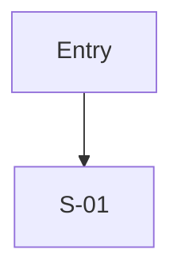

# APP-FLOW — Screens and Navigation

> Every screen and every button outcome, so pages connect instead of existing in isolation. Screens are not added without a supporting PRD feature.

## 1. Entry points
First visit · returning user · shared or deep link.

## 2. Authentication flow
Sign up · sign in · verification · password recovery · sign out · expired session.

## 3. Screen inventory

One block per screen:

### S-01 <Screen name>
- Route:
- Purpose · PRD feature (F-xx):
- Entry conditions (who can reach it, from where):
- Main content:
- Primary action → destination:
- Secondary actions → destination:
- States: loading · empty · error · success
- Notes:

## 4. Action matrix

| Screen | Trigger / button | Condition (auth, data) | Feedback | Next screen |
|---|---|---|---|---|

## 5. Primary journey
The complete happy path from entry to the core outcome.

## 6. Secondary journeys and decision points

## 7. Edge cases and recovery
Invalid input · failed request · lost connection · missing permission · expired session · cancelled action.

## 8. Navigation rules
Global navigation · back behavior · protected routes · deep links.

## 9. Flow diagram

## 10. Traceability
| Feature | Screens |
|---|---|
| F-01 | S-01 |

## Change log

| Date | What changed | Approved by |
|---|---|---|

## Approval record

Date · criteria met · owner decision
