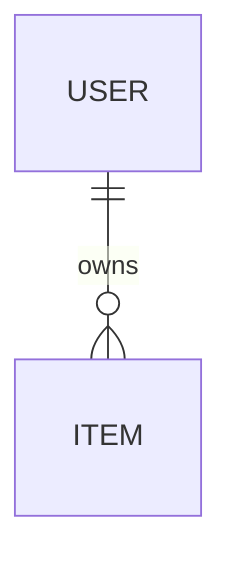

# SCHEMA — Data and Access

> How data is stored, connected and protected. Every entity supports a named feature (F-xx). This is the hardest document to change once real data exists.

## 1. Data overview
Database type · main data domains · ownership model.

## 2. Authentication and authorization
- User identity · sign-in methods · session handling:
- Roles and permissions:

| Role | Can do | Cannot do |
|---|---|---|

## 3. Entities

One block per entity:

### E-01 <entity / table name>
- Purpose · feature (F-xx):

| Column | Type | Required | Default | Validation | Unique / Index | Reference |
|---|---|---|---|---|---|---|

- Created and updated timestamps:
- Size L: tenant column and tenant-aware references:

## 4. Relationships
One-to-one · one-to-many · many-to-many · delete behavior. Add an ER diagram:

## 5. Access rules (per entity)

| Entity | Who can create | Read | Update | Delete |
|---|---|---|---|---|

Enforced on the server side or by row-level rules, never only in the browser.

## 6. Core data operations and transactions

## 7. File storage
Buckets or folders · allowed types and sizes · access rules.

## 8. Integrity and security
Validation · transactions · sensitive data (what, how protected) · audit requirements · retention and deletion.

## 9. Migrations and seed data

## 10. Traceability
| Entity | Supports features |
|---|---|
| E-01 | F-01 |

## 11. Risks and open questions
| # | Question | Recommended default | Owner's answer |
|---|---|---|---|

## Change log

| Date | What changed | Approved by |
|---|---|---|

## Approval record

Date · criteria met · owner decision · reviewer agents
