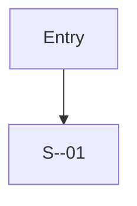

# <Module> — APP-FLOW (size L)

> Screens and flows of this module only. Uses the global navigation rules and the PATTERNS tokens.

## Screens

### S-<module>-01 <name>
- Route · purpose · feature (F-<module>-xx):
- Entry conditions:
- Main content:
- Primary action → destination:
- Secondary actions → destination:
- States: loading · empty · error · success

## Action matrix

| Screen | Trigger / button | Condition | Feedback | Next screen |
|---|---|---|---|---|

## Journeys and edge cases

## Flow diagram

## Traceability
| Feature | Screens |
|---|---|

## Change log

| Date | What changed | Approved by |
|---|---|---|

## Approval record

Date · criteria met · owner decision
